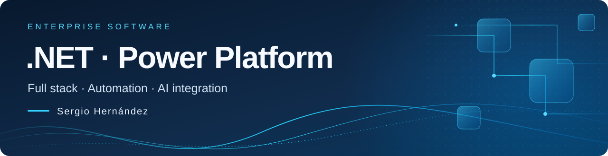
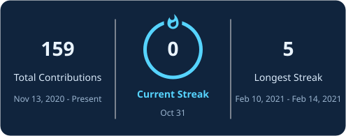

<a href="./README.md">Español</a> · <strong>English</strong>

  

  
  
  

## About me

I am **Sergio Alejandro Hernández Patiño**, a **.NET and Microsoft Power Platform developer** based in Cali, Colombia. I bring **more than six years of experience** combining software development, consulting and technical leadership.

I build full stack applications with **React and .NET**, business applications and automation with **Power Platform**, and integrations using **REST APIs and Azure**. I also integrate language models into applications and workflows through APIs.

I contribute from analysis and design through testing, deployment and software evolution. My focus is connecting systems and translating business needs into clear, maintainable solutions.

## Technologies and focus

  
  
  
  
  
  
  
  
  

| Area | Technologies and capabilities |
| :--- | :--- |
| **Full stack applications** | React, JavaScript, TypeScript, C#, ASP.NET Core/Web API, Entity Framework Core and LINQ. |
| **Power Platform** | Canvas and model-driven Power Apps, Dataverse, plug-ins, PCF, Power Automate, RPA, custom connectors, solutions and ALM. |
| **Integration and data** | REST APIs, Azure App Service, Azure Functions, Azure Storage, SQL Server and Power BI. |
| **Applied AI** | Language model integration through APIs in applications and automation, with technical review of the results. |

Education, languages and additional experience

- **Education:** Technology degree in Information Systems Analysis and Development (ADSI), SENA, 2019–2021.
- **Languages:** native Spanish and intermediate English (B1).
- **Earlier experience:** Java, Spring Boot, Angular, Oracle and PL/SQL for business services and web interfaces.
- **Tools and ecosystem:** Git, GitHub, Microsoft 365 and SharePoint.

My full experience, including employers, dates and responsibilities, is available in my [professional CV](https://sergio-hernandez-cv.alejosergio3000.chatgpt.site/en/).

## Public code and projects

| Project | What you will find |
| :--- | :--- |
| [**Bilingual CV website**](https://github.com/alejandrosergio/sergio-hernandez-cv) | HTML, CSS and JavaScript; accessibility, light/dark themes, and concise and complete printable CVs in English and Spanish. [Visit website](https://sergio-hernandez-cv.alejosergio3000.chatgpt.site/en/). |
| [**Nexos**](https://github.com/alejandrosergio/Nexos) | Java development technical assessment. |

[Explore public repositories →](https://github.com/alejandrosergio?tab=repositories)

## GitHub activity

  
  

  

<picture>
  <source media="(prefers-color-scheme: dark)" srcset="./profile/snake-dark.svg" />
  
</picture>

These metrics reflect public GitHub activity; they do not represent all of my professional experience. Language distribution depends on published code. The cards and animation refresh daily through <a href="https://github.com/alejandrosergio/alejandrosergio/actions/workflows/profile-visuals.yml">GitHub Actions</a>.

## Contact

**[alejandro.dev.sergio@outlook.com](mailto:alejandro.dev.sergio@outlook.com)** · [LinkedIn](https://www.linkedin.com/in/sergio-alejandro-hernandez-patino/) · [CV / Résumé](https://sergio-hernandez-cv.alejosergio3000.chatgpt.site/en/)

Visual credits

Custom header aligned with my CV and LinkedIn. Cards: [GitHub Readme Stats](https://github.com/stats-organization/github-readme-stats-action) and [GitHub Readme Streak Stats](https://github.com/DenverCoder1/github-readme-streak-stats). Animation: [Platane/snk](https://github.com/Platane/snk).

