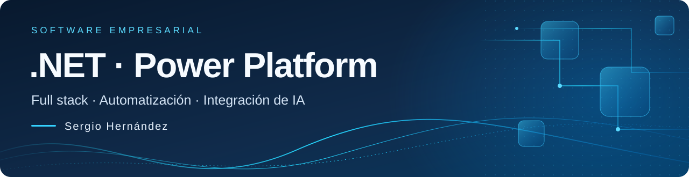

<strong>Español</strong> · <a href="./README.en.md">English</a>

  

  
  
  

## Sobre mí

Soy **Sergio Alejandro Hernández Patiño**, desarrollador **.NET y Microsoft Power Platform** en Cali, Colombia. Aporto **más de seis años de experiencia** combinando desarrollo de software, consultoría y liderazgo técnico.

Desarrollo aplicaciones full stack con **React y .NET**, aplicaciones empresariales y automatizaciones con **Power Platform**, e integraciones con **APIs REST y Azure**. También integro modelos de lenguaje mediante APIs en aplicaciones y flujos de trabajo.

Participo desde el análisis y el diseño hasta las pruebas, el despliegue y la evolución del software. Mi enfoque es conectar sistemas y traducir necesidades de negocio en soluciones claras y mantenibles.

## Tecnologías y enfoque

  
  
  
  
  
  
  
  
  

| Área | Tecnologías y capacidades |
| :--- | :--- |
| **Aplicaciones full stack** | React, JavaScript, TypeScript, C#, ASP.NET Core/Web API, Entity Framework Core y LINQ. |
| **Power Platform** | Power Apps canvas y model-driven, Dataverse, plugins, PCF, Power Automate, RPA, conectores personalizados, soluciones y ALM. |
| **Integración y datos** | APIs REST, Azure App Service, Azure Functions, Azure Storage, SQL Server y Power BI. |
| **IA aplicada** | Integración de modelos de lenguaje mediante APIs en aplicaciones y automatizaciones, con revisión técnica de los resultados. |

Formación, idiomas y experiencia adicional

- **Formación:** Tecnólogo en Análisis y Desarrollo de Sistemas de Información (ADSI), SENA, 2019–2021.
- **Idiomas:** español nativo e inglés B1 intermedio.
- **Experiencia anterior:** Java, Spring Boot, Angular, Oracle y PL/SQL en desarrollo de servicios e interfaces empresariales.
- **Herramientas y ecosistema:** Git, GitHub, Microsoft 365 y SharePoint.

La trayectoria completa, con empresas, fechas y responsabilidades, está en el [CV profesional](https://sergio-hernandez-cv.alejosergio3000.chatgpt.site/).

## Código y proyectos públicos

| Proyecto | Qué encontrarás |
| :--- | :--- |
| [**Currículum web bilingüe**](https://github.com/alejandrosergio/sergio-hernandez-cv) | HTML, CSS y JavaScript; accesibilidad, temas claro/oscuro y CV resumido y completo para imprimir en español e inglés. [Ver sitio](https://sergio-hernandez-cv.alejosergio3000.chatgpt.site/). |
| [**Nexos**](https://github.com/alejandrosergio/Nexos) | Prueba técnica de desarrollo en Java. |

[Explorar repositorios públicos →](https://github.com/alejandrosergio?tab=repositories)

## Actividad en GitHub

  
  

  

<picture>
  <source media="(prefers-color-scheme: dark)" srcset="./profile/snake-dark.svg" />
  
</picture>

Las métricas reflejan actividad pública en GitHub; no representan toda mi experiencia profesional. El reparto de lenguajes depende del código publicado. Las tarjetas y la animación se actualizan diariamente mediante <a href="https://github.com/alejandrosergio/alejandrosergio/actions/workflows/profile-visuals.yml">GitHub Actions</a>.

## Contacto

**[alejandro.dev.sergio@outlook.com](mailto:alejandro.dev.sergio@outlook.com)** · [LinkedIn](https://www.linkedin.com/in/sergio-alejandro-hernandez-patino/) · [CV / Résumé](https://sergio-hernandez-cv.alejosergio3000.chatgpt.site/)

Créditos de los elementos visuales

Cabecera propia, alineada con el CV y LinkedIn. Tarjetas: [GitHub Readme Stats](https://github.com/stats-organization/github-readme-stats-action) y [GitHub Readme Streak Stats](https://github.com/DenverCoder1/github-readme-streak-stats). Animación: [Platane/snk](https://github.com/Platane/snk).

